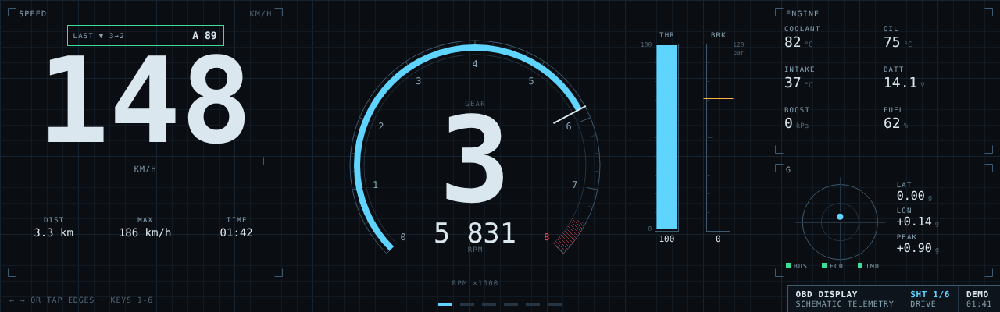
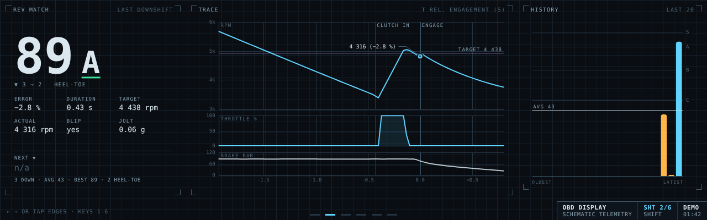
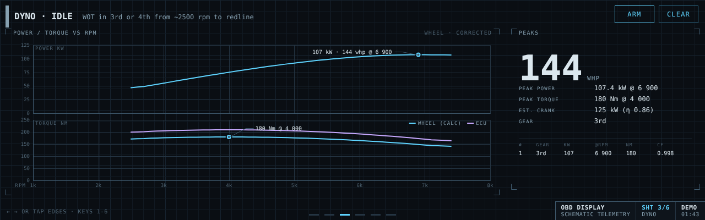
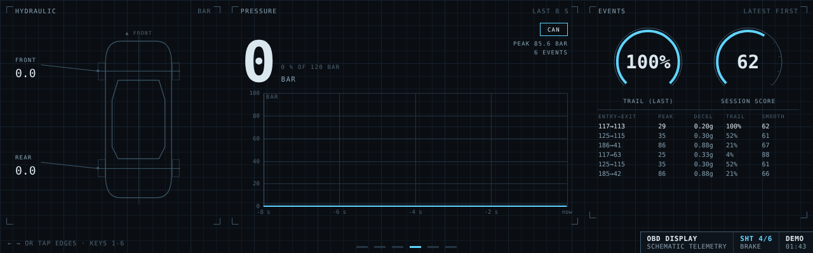
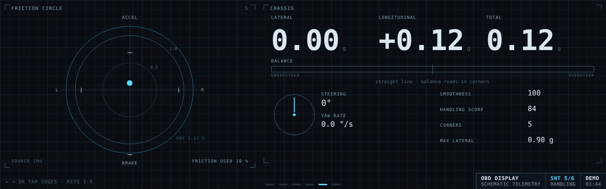

# obddash

**A schematic-style telemetry display for your car, driven by OBD-II and the CAN bus.**
obddash turns a Raspberry Pi, a $15-50 CAN interface and a bar-shaped touchscreen into
a dash that does more than show numbers: it scores every downshift's rev-match, runs a
virtual dyno from a full-throttle pull, analyses how you brake, and draws your G-forces
on a friction circle, all in the clean line-work of an engineering drawing. It reads
the same standard OBD-II data every scan tool does, plus whatever extra signals your
car broadcasts (brake pressure, steering angle, wheel speeds) once you map them. It
never writes to the car.



> **Also in this repo: [LeanBuddy](leanbuddy/)**, a toy for motorbikes: a round-screen
> character that reads your lean angle and G-forces and reacts with animations.

> **Status: early (v0.1).** The whole pipeline, including the real OBD-II and CAN
> signal decoding, is exercised end to end against the built-in simulator on a virtual
> CAN bus. On a real car, expect to spend an evening on the vehicle file: gear ratios,
> tyre size, mass, and the car-specific signals. Reports from real cars are very
> welcome.

## What it shows

Six pages; swipe, tap the screen edges, or press ← → / 1-6.

| Page | What it is for |
|---|---|
| **DRIVE** | Speed, an rpm arc with redline and shift light, the gear, throttle and brake bars, engine readouts (coolant, oil, intake, battery, boost, fuel) and a mini friction circle. |
| **SHIFT** | Rev-match coaching: every downshift is graded S to D from how close the engine was to the new gear's rpm when the clutch bit, with blip and heel-toe detection and the rpm / throttle / brake traces of the shift. |
| **DYNO** | A virtual chassis dyno: hold full throttle in one gear and get wheel power and torque curves from the car's own acceleration, SAE-corrected, with the ECU's torque figure overlaid and saved runs to compare. |
| **BRAKE** | Brake pressure (from CAN, or clearly marked ESTIMATED), a live trace, and each braking event's peak, deceleration, trail-braking share and smoothness. |
| **HANDLING** | A friction circle with a G trail, peaks, how much of your demonstrated grip is in use, understeer/oversteer balance, smoothness and corner count. |
| **SYSTEM** | Link health (bus, ECU, IMU, request and frame rates), the vehicle settings, and a raw dump of every telemetry field for diagnostics. |

## Screenshots

| | |
|---|---|
|  |  |
| **SHIFT**: the last downshift's grade and traces | **DYNO**: power and torque from a pull in 3rd |
|  |  |
| **BRAKE**: pressure trace and braking events | **HANDLING**: friction circle and balance |

The UI is designed for a landscape **1280×400** bar display and also lays out for
1024×600; other sizes scale between the two.

## Quick start (no car needed)

```bash
python -m venv .venv && . .venv/bin/activate && pip install -e ".[dev]"
obddash sim
# open http://localhost:8080
```

`obddash sim` runs a simulated 6-speed sports car (physics, a scripted driver and a fake
ECU answering OBD requests) on a virtual CAN bus, through exactly the code a real car
goes through. `--script dyno` does full-throttle pulls, `--script highway` cruises.

No Python at all? Open `src/obddash/web/index.html` in a browser, or add `?demo=1` to the
URL of a running server: the UI then runs its own in-browser demo.

## Which cars work

Any car with OBD-II over CAN at the port gets the core features: speed, rpm, gear, rev-match
scoring, the virtual dyno and estimated brake pressure. Measured brake pressure and chassis
data depend on the car. Some, like the GT86/BRZ, MX-5 NC and Focus RS Mk3, carry them at the
OBD port; others need a tap on an internal connector; 1990s JDM cars need an aftermarket ECU
or a sensor box. [docs/vehicle-compatibility.md](docs/vehicle-compatibility.md) lists JDM and
European performance cars by support level, with tap points and sources.

## Hardware

| Slot | Recommended | More |
|---|---|---|
| Computer | Raspberry Pi 5 (2-4 GB); a Pi 4 works | [BOM](hardware/BOM.md#1-computer) |
| CAN interface | Waveshare 2-CH CAN FD HAT (MCP2518FD, isolated), or an MCP2515 HAT / PiCAN, or a USB adapter | [BOM](hardware/BOM.md#2-can-interface-the-important-part) |
| Display | 7.9" 400×1280 touch bar display rotated to 1280×400, or the Raspberry Pi Touch Display 2 | [BOM](hardware/BOM.md#3-display) |
| Car connection | OBD-II to DB9 cable (mind the two DB9 pinouts) | [wiring](hardware/wiring.md) |
| Power | ignition-switched and fused: a 12→5 V 5 A buck, a USB-C PD car adapter, or a shutdown controller. **Not** OBD pin 16 | [wiring](hardware/wiring.md#power) |
| G-forces | MPU-6050 breakout on I2C (optional) | [wiring](hardware/wiring.md#imu-mpu-6050-on-i2c) |

Roughly $250-400 in October 2026 prices; a $60-90 build uses a Pi Zero 2 W, a USB CAN
adapter and your phone as the screen. Setting up the Pi from a blank SD card,
including the kiosk browser and persistent `can0`, is in
**[hardware/pi-setup.md](hardware/pi-setup.md)**, and mostly comes down to:

```bash
git clone https://github.com/dasaijapan-gif/Obd-display-.git ~/obddash && cd ~/obddash
./deploy/setup-pi.sh --hat mcp251xfd     # or --hat mcp2515 --oscillator 16000000, --hat usb
sudo reboot
```

Other routes (ESP32 gauges, USB adapters on a laptop, ELM327 dongles and why they are
too slow) are in [hardware/alternatives.md](hardware/alternatives.md).

## Running on the car

With the interface wired and the ignition on:

```bash
obddash pids            # does the ECU answer? VIN, supported PIDs, live values (exit 1 if silent)
obddash scan            # every CAN id on the bus, its rate, and which bytes are changing
obddash scan --diff     # baseline at rest, then press the brake / turn the wheel: candidates ranked
obddash run             # the dashboard: CAN (+ IMU) -> metrics -> http://localhost:8080
obddash run --record    # ...and record the raw signals to recordings/*.jsonl
obddash replay recordings/<file>.jsonl --speed 2    # re-run a drive through the metrics
obddash config-check    # the resolved config, the per-gear rpm table, and warnings
```

On the Pi, `deploy/obddash.service` runs `obddash run` at boot and
`deploy/obddash-kiosk.service` opens it full-screen in Chromium.

## Configuration

Two YAML files:

* **The app config**, [`config/default.yaml`](config/default.yaml): the CAN interface
  and bitrate, OBD polling, web server, IMU and its mounting axes, metric thresholds,
  recording. Everything has a default.
* **The vehicle file**, named by `vehicle_file:`, in
  [`config/vehicles/`](config/vehicles/): the physics the gear estimate and dyno need
  (gear ratios, final drive, tyre circumference, mass, drag, redline) and the car's own
  broadcast signals. Start from
  [`template_full.yaml`](config/vehicles/template_full.yaml); `generic_obd.yaml` works
  with any car using standard PIDs only.

**Finding your car's signals.** Brake pressure, steering angle, wheel speeds and the
clutch switch are not part of OBD-II. Park, run `obddash scan --diff`, let it record a
baseline, then work one control at a time (press the brake slowly, turn the wheel lock
to lock) and note which bytes of which id move. Community DBC files such as
[opendbc](https://github.com/commaai/opendbc) already describe many cars. On some cars
the OBD port sits behind a gateway that passes no broadcast traffic; standard OBD-II
still works there ([BOM](hardware/BOM.md#4-car-connection)).

**The DBC convention, in one paragraph.** Signals are described the way DBC files and
`cantools` describe them: an arbitration `id`, a `start_bit`, a `length` in bits, a
`byte_order`, `signed`, then `value = raw × scale + offset`, with optional `min`/`max`
sanity limits. For `little_endian` (Intel) the start bit is the signal's *least*
significant bit, numbered so that bit 0 is the LSB of byte 0 and bit 8 the LSB of byte 1;
for `big_endian` (Motorola) it is the *most* significant bit in the same numbering (bit
7 is the MSB of byte 0). For the common byte-aligned case, give `byte:` (0-based) and
`length:` instead and skip the bit arithmetic. Names must match `obddash.model.Sig`
(`brake_pressure_bar`, `steering_deg`, ...) for the metrics to use them.

```yaml
signals:
  - { name: brake_pressure_bar, id: 0x200, byte: 0, length: 16, scale: 0.01, min: 0, max: 250 }
  - { name: steering_deg,       id: 0x201, byte: 0, length: 16, signed: true, scale: 0.1 }
  - { name: brake_switch,       id: 0x200, start_bit: 48, length: 1 }
```

## How the metrics work

* **Gear**: from the rpm-to-speed ratio against your gear ratios (±6 % window), or from
  the car's own gear signal.
* **Rev-match score**: the rpm when the clutch bites vs. the rpm the new gear needs at
  that speed. Full marks within 2 %, zero beyond 15 %, under-revving penalised 1.5×,
  plus timing, blip and jolt terms; graded S ≥ 95, A ≥ 85, B ≥ 70, C ≥ 50, D.
* **Virtual dyno**: `F = m·k·a + ½ρ·Cd·A·v² + Crr·m·g`, `P = F·v`, torque `= P / ω`,
  binned by rpm, smoothed and SAE-corrected. Wheel power, not crank power.
* **Brakes**: pressure from CAN, or estimated from deceleration while the brake switch is
  on; events, trail-braking share and smoothness.
* **Handling**: G from the IMU, or derived from yaw rate or steering angle; a friction
  circle with an adaptive envelope, balance from measured vs. expected yaw rate.

The full explanation, with worked examples, limitations (why the dyno reads lower than
the brochure) and the config keys that tune each one:
**[docs/metrics.md](docs/metrics.md)**.

## Architecture

```
                 ┌─────────────────────────────── Raspberry Pi ───────────────────────────────┐
  OBD-II port    │  CAN HAT   ┌──────────────┐          ┌───────────────┐      ┌───────────┐ │
  ─ CAN-H/L ─────┼─ can0 ───▶ │  bus.reader  │ RawState │ metrics.engine│ Telem│  server   │ │   Chromium
                 │            │ obd + signals│ ───────▶ │ gears/shifts/ │ ────▶│ FastAPI   │─┼─▶ kiosk
  MPU6050 (I2C) ─┼──────────▶ │ sensors.imu  │          │ dyno/brakes/  │      │ WebSocket │ │   web/
                 │            └──────────────┘          │ handling      │      └───────────┘ │
                 │  `obddash sim` replaces can0 with a   └───────────────┘  recorder.jsonl    │
                 │  virtual bus + sim.ecu (fake car)                                          │
                 └────────────────────────────────────────────────────────────────────────────┘
```

Three stages, two contracts: everything that reads the car writes raw signals into a
`RawState` under the names in `obddash.model.Sig`; the metrics engine turns that into a
`Telemetry` snapshot 50 times a second; the server sends it as JSON over a WebSocket at
30 Hz and the browser draws it. A new data source or a new metric needs no changes on
the other side of its contract. Details, including the JSON format and the threading
model: [docs/architecture.md](docs/architecture.md).

## Project layout

```
├── config/
│   ├── default.yaml          app config: CAN interface, server, IMU, metric tuning
│   └── vehicles/             one file per car: generic_obd, sim_sportscar, template_full
├── deploy/                   systemd units, can0 .network file, setup-pi.sh, kiosk launcher
├── docs/                     architecture, metrics, roadmap, FAQ, screenshots/
├── hardware/                 BOM, wiring, Pi setup, alternatives
├── src/obddash/
│   ├── model.py              Sig names, RawState, Telemetry: the contracts
│   ├── config.py             pydantic config models and YAML loaders
│   ├── cli.py                obddash run | sim | replay | scan | pids | config-check
│   ├── bus/                  OBD-II over CAN (ISO-TP, PID table), DBC-style signals, reader, scan
│   ├── sensors/              MPU-6050 IMU over I2C
│   ├── metrics/              engine + gears, shifts, dyno, brakes, handling, session
│   ├── sim/                  vehicle physics, scripted driver, fake ECU on a virtual bus
│   ├── server/               runtime, FastAPI app and WebSocket, recorder / replayer
│   └── web/                  the schematic UI: vanilla JS + canvas, no build step
└── tests/
```

## Development

```bash
pip install -e ".[dev]"          # pytest, pytest-asyncio, httpx, websockets, ruff, playwright
pytest                            # the test suite (the simulator stands in for a car)
ruff format . && ruff check .     # formatting and lint (line length 100, Python 3.11+)
python -m playwright install chromium   # once, for the browser-based UI checks and screenshots
```

The code targets Python 3.11+ and runs on a Raspberry Pi at 50 Hz, so the hot paths are
plain Python with no numpy. Each module starts with a docstring explaining its approach;
the metric modules document their formulas constant by constant. Optional extras:
`.[imu]` (smbus2, for the MPU-6050) and `.[dbc]` (cantools, for loading `.dbc` files).

## Roadmap and FAQ

Next up: GPS lap timing, data export, more IMU drivers, a coast-down calibration for the
dyno, per-corner analysis and a 3D-printed housing: [docs/roadmap.md](docs/roadmap.md).
Questions like "will this void my warranty?" and "why does my brake pressure say
ESTIMATED?": [docs/faq.md](docs/faq.md).

## Safety

obddash only listens and sends standard read-only OBD-II requests, but you are still
wiring electronics into a car. Fuse every 12 V connection, never power it from the
always-live OBD pin 16, never touch airbag or ABS wiring, and keep the dyno pulls for a
track or a closed road. See [hardware/wiring.md](hardware/wiring.md#safety).

## License

[MIT](LICENSE).
