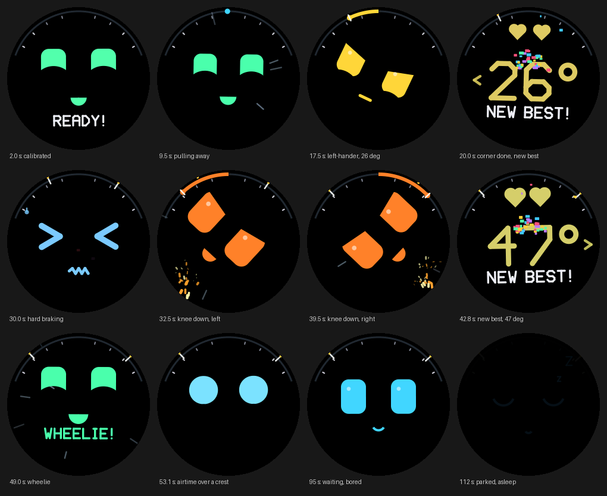
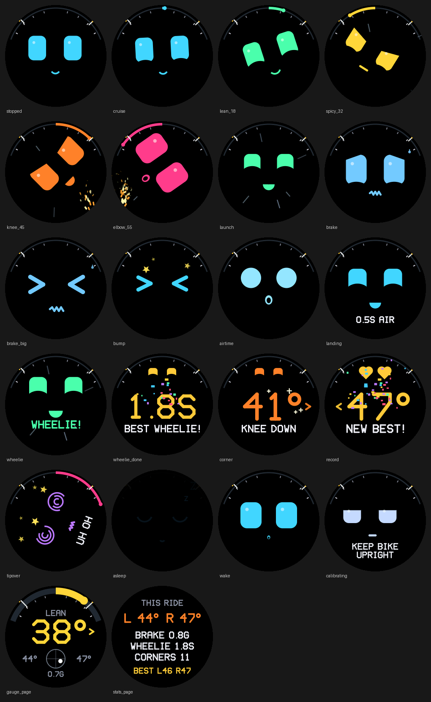

# LeanBuddy

**A little round-screen character that rides on your motorbike.** It measures how far
you lean the bike and the G-forces of braking, accelerating and cornering, and reacts
with animations: it looks into the corner with you, gets more excited the further you
lean, throws sparks at knee-down angles, squeezes its eyes shut under hard braking,
cheers wheelies, floats over crests, celebrates a new personal-best lean angle, and
falls asleep when you park.



The face is **horizon-locked**: the screen leans with the bike, and the face rotates
the other way so it stays level with the world, the way a rider keeps their head level
through a corner.

> **Status: prototype (v0.1).** The lean estimation, ride brain, animations and
> renderer are complete and tested against a physics-based ride simulator. The
> firmware compiles and links for the ESP32-S3 (arduino-esp32 2.0.17, LovyanGFX) but
> has not run on real hardware yet. See [Next steps](#next-steps).

## Try it without hardware

```bash
cd leanbuddy
python3 -m http.server -d sim 8000     # then open http://localhost:8000
```

The simulator runs **the same C code as the device**, compiled to WebAssembly: a scripted
canyon ride, or "ride it yourself" with the arrow keys. "Phone sensors" turns a phone
into the toy (hold it upright, screen facing you, and tilt it); browsers only give
motion sensors to pages served over HTTPS, so host the `sim` folder somewhere that has
it, such as GitHub Pages. `python3 tools/bundle_sim.py` makes a single-file version that
opens without a server.

## How it works

```
QMI8658 IMU ──200 Hz──▶ lean.c ──▶ brain.c ──▶ face.c ──▶ gfx.c ──▶ 240×240 round LCD
 accel + gyro           lean angle   events,    expressions,  anti-aliased
                        G-forces     records    particles     SDF renderer
```

| Part | What it does |
|---|---|
| [`core/lean.c`](core/lean.c) | Lean angle, wheelie pitch and G-forces from the accelerometer and gyro. Learns how the toy is mounted, the gyro's bias, and corrects itself while riding. [How lean is measured](docs/how-lean-works.md). |
| [`core/brain.c`](core/brain.c) | Turns that into reactions (launch, hard braking, bump, airtime, wheelie, tip-over), corner reports, personal records and sleep. |
| [`core/face.c`](core/face.c) | The character: spring-animated eyes, lids and mouth, particles, the lean gauge round the rim, and three pages (face, gauge, ride stats). |
| [`core/gfx.c`](core/gfx.c) | A small software renderer: every shape is a signed distance field, so edges are anti-aliased and the whole face can rotate. Includes a stroke font. |
| [`core/ridesim.c`](core/ridesim.c) | A motorbike ride simulator that produces realistic IMU data: coordinated turns, braking dive, wheelies, bumps, airtime, engine vibration, sensor noise and bias, a tilted and twisted mount. |
| [`firmware/`](firmware/) | ESP32-S3 firmware (PlatformIO, Arduino framework). |
| [`sim/`](sim/) | The browser simulator. |

The core is plain C11 with no dependencies at all (it even carries its own trig), so the
same code builds for the ESP32, natively for the tests, and as freestanding WebAssembly.

### Reactions



| Trigger | Reaction |
|---|---|
| Lean under 10° | Calm cyan face, idle glances, blinks |
| 10–25° | Mint, happy, eyes look into the corner |
| 25–40° | Yellow, focused eyes |
| 40–50° | Orange, wide eyes, sparks from the road on the inside of the turn |
| 50°+ | Hot pink, "woah" mouth, shaking, more sparks |
| Corner over 18° finished | Corner report: peak angle, direction, "NICE / SPICY / KNEE DOWN / ELBOW!" |
| New deepest lean, each side | Heart eyes, "NEW BEST!", confetti; saved to flash |
| Braking over 0.45 g | Worried eyes, sweat drops; over 0.75 g squeezed ">  <" eyes |
| Accelerating over 0.3 g | Happy squint, speed lines |
| Pothole | Squash-and-stretch jolt, stars on big ones |
| Crest (near 0 g) | Round eyes floating up, then a landing squash and the airtime |
| Wheelie (front up 8°+) | "WHEELIE!", then how long it lasted |
| Lying on its side | Dizzy spiral eyes, "UH OH" |
| Waiting at the lights | Looks around, yawns when bored |
| Parked 20 s | Closes its eyes, Zzz, dims the backlight |

Tap the screen to switch to the **lean gauge** (big number, G-ball, this ride's
peaks) or **ride stats**.

### Designed not to distract

A screen on a motorbike must never pull your eyes off the road. So while the bike is
leaned over, the face only changes in ways you can take in from the corner of your
eye: colour and where the eyes look. Text and numbers (the corner report, a new record)
are queued and shown only once the bike has been upright for a moment, and a live
reaction such as hard braking always takes priority over them.

## Hardware

One off-the-shelf board has everything: the **Waveshare ESP32-S3-Touch-LCD-1.28**
(about US$20): ESP32-S3, a 1.28" 240×240 round IPS screen, a QMI8658 6-axis IMU,
touch, and a LiPo charger. Add a small LiPo cell or 5 V from the bike, and a case.
See [hardware/BOM.md](hardware/BOM.md) and [hardware/mounting.md](hardware/mounting.md).

```bash
cd leanbuddy/firmware
pio run -t upload && pio device monitor
```

First run: send `o` in the serial monitor for the orientation wizard (lay it screen-up,
then hold it upright), mount it, then hold the bike upright and still until the face
says READY. Hold the BOOT button (or touch the screen) for 2 s to recalibrate.
Serial commands: `c` recalibrate, `p` next page, `d` stream telemetry as CSV, `r` reset
records.

## Development

```bash
cd leanbuddy
make test        # math, lean estimation, brain and rendering tests (native C)
make wasm        # sim/leanbuddy.wasm (needs clang with the wasm32 target)
make gallery     # docs/expressions.png
```

`tools/render_frames.c` renders any moment of the scripted ride to images, and
`tools/gallery.c` renders every expression, for designing animations without hardware.

Accuracy on the simulated canyon ride (200 Hz, realistic noise, vibration and gyro
bias, the toy mounted tilted 25° and twisted 3°): **0.6° RMS lean error, 1.7° worst**,
cornering G within 0.02 g. Across 24 combinations of mount angle and sensor noise it
stays under 2.5° RMS. Booting on the side stand (a 12° wrong start) corrects itself
within about 30 s of riding.

## Next steps

1. **Flash a board and ride.** The firmware has not run on hardware yet. Check
   that the lean direction is right (lean the toy right: the rim gauge fills
   clockwise), check the frame rate (a frame takes 0.7 ms on a desktop; expect
   20-35 ms on the ESP32-S3, so raise `FRAME_MS` in `firmware/src/config.h` if
   needed), and log a real ride with `d` to tune the thresholds in `brain.c`.
2. **Replay real rides.** Feed logged CSVs back through the core (like `ridesim.c`)
   so real-world data becomes regression tests.
3. **Battery life.** Deep sleep with the IMU's wake-on-motion interrupt when parked.
4. **Enclosure.** A printable case with a standard handlebar or ball mount.
5. **A companion app** over BLE: ride history, records, choosing characters.
